  

<h1 align="center">Hey, I'm Joshua 👋</h1>

  <b>Full-Stack Developer · Process Automation · Python, Next.js & Oracle PL/SQL</b> 
  Turning manual, document-heavy work into reliable software, from Colombia

  <a href="joshua-ortiz-dev.vercel.app/)">🌐 Portfolio</a> ·
  <a href="https://www.linkedin.com/in/joshua-ort%C3%ADz-a785022b0/">💼 LinkedIn</a>

---

### About me

I'm a junior full-stack developer in the healthcare sector, where I lead **process automation** and **platform support**. I build **Python + Playwright bots** for third-party web portals that have no API, **document and data pipelines** that cross Excel, PDF and relational databases, and **internal web apps** in Next.js and React with the business logic in Oracle PL/SQL.

My rule of thumb: a tool isn't done until it **proves its own output**. Every run validates what it produces, leaves an audit log, never touches the original file and can resume where it stopped.

---

### What I'm working on

🤖 **Process automation** — bots that log in, find the right records, validate every PDF and keep a full trace of each run.

🧩 **Internal tools** — incident and requirements management with SLA tracking, traceability reports and automated tests.

🎓 **Software Engineering @ Jala University** — studying while building in production.

🌱 **Next up** — Docker and CI with GitHub Actions.

---

### Tech Stack

---

### Featured work

| Project | What it is | Stack |
|---|---|---|
| [portfolio](https://github.com/spartancreed22/portfolio) | My personal site, with an engineering write-up for each project | Next.js · React · TypeScript |
| [TaskFlow](https://github.com/spartancreed22/TaskFlow) | Task manager that consumes the DummyJSON API | Next.js 14 · TypeScript · Tailwind |
| [Real-estate management demo](https://github.com/spartancreed22/DEMO_Gestin-de-Desarrollos-Inmobiliarios-con-IA) | Clickable prototype: budget dashboard, collections and purchasing | HTML · CSS · JavaScript |
| [My-Learning](https://github.com/spartancreed22/My-Learning) | Notes and exercises from my path as a software developer | JavaScript |

> 🔒 Most of my day-to-day code lives in private repositories because it handles healthcare data. Happy to walk through the engineering decisions behind it in an interview.

<i>Open to remote or hybrid roles and freelance automation projects · Spanish (native) · English (professional)</i>

